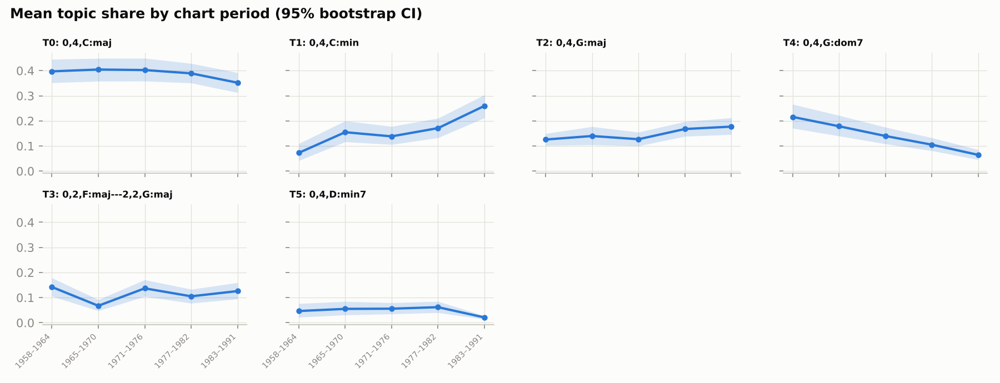
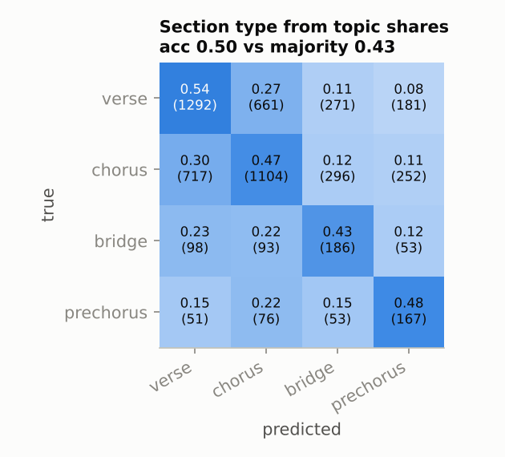
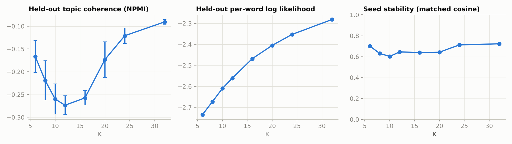
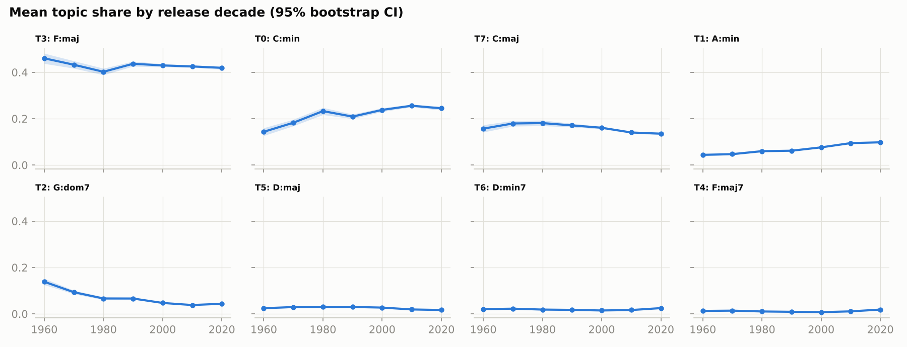
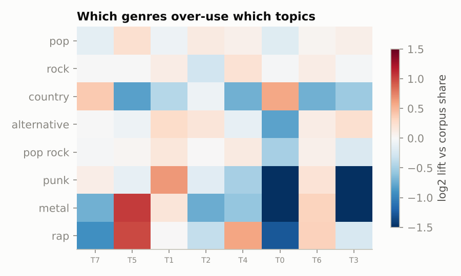
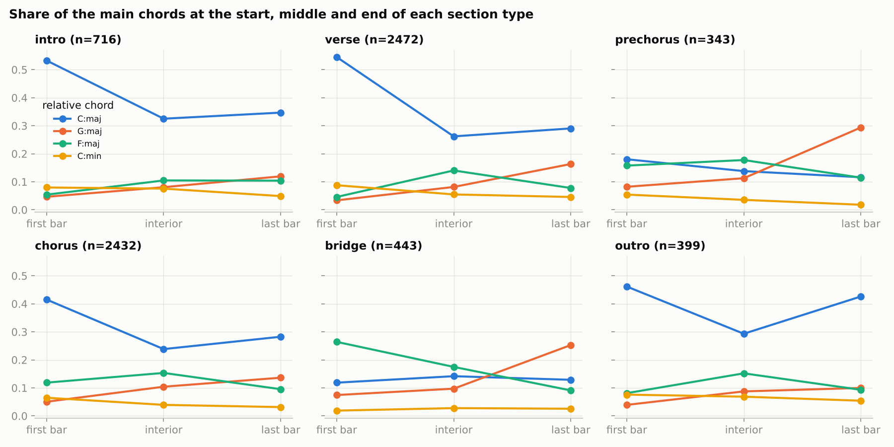
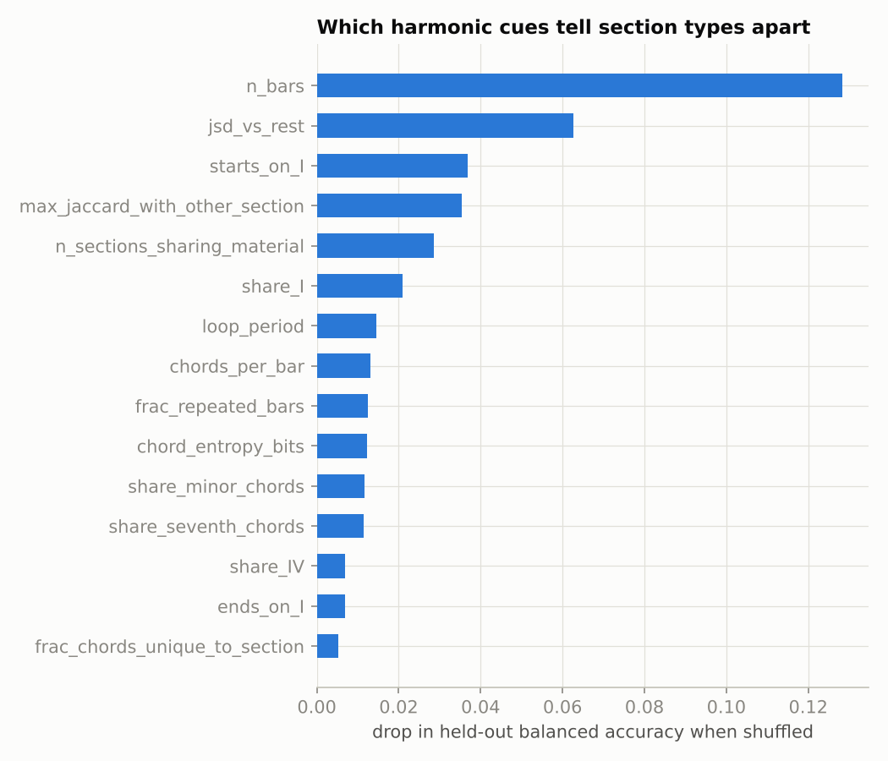

# Topic models of chord progressions in popular music

Latent Dirichlet Allocation over *bargrams* — one bar of harmony, with the
onset and duration of each chord, spelled relative to the local key — on
two corpora:

* the **McGill Billboard** corpus (890 expert-annotated Hot 100 songs, 1958–1991;
  Burgoyne, Wild & Fujinaga 2011), which has metre, section labels and key
  changes, and
* **Chordonomicon** (Kantarelis et al. 2024), 680k crowd-sourced chord sheets
  with section tags, genre and release date but no rhythm or key, of which a
  40,000-song sample with release dates is used.

The question is the one from the original 2015 project: do the "tonal
systems" music theorists describe for rock (Everett 2004; Biamonte 2010;
de Clercq & Temperley 2011) fall out of an unsupervised model, and do the
resulting topics say anything about song structure and chart year?

This is a from-scratch rewrite of that project. The `legacy/` folder keeps the
original notebooks and slides; the section at the end lists what was wrong with
them and what changed.

## Results on Billboard (K = 6)

Six topics, trained on 708 songs and evaluated on 178 held-out songs the model
never saw. Roots are relative to the local tonic (C = I); a token like
`0,2,F:maj---2,2,G:maj` is a bar with IV on beats 1–2 and V on beats 3–4.

| Topic | Share | Top tokens (probability) | Reading | Example songs |
|---|---|---|---|---|
| 0 | 0.38 | I (.49) IV (.28) V (.11) II (.03) | plain diatonic major, one chord a bar | The Joker; Wanna Be Startin' Somethin'; Bust A Move |
| 1 | 0.16 | i (.22) ♭VII (.19) ♭VI (.12) ♭III (.09) iv (.07) i7 (.06) | the flat-side / Aeolian system | Let The Music Play; There's the Girl; Lambada |
| 2 | 0.15 | V (.24) vi (.20) I–IV half-bars (.11) IV–I half-bars (.09) ii (.07) iii (.05) | sharp-side diatonic with faster harmonic rhythm | Just Like Heaven; Here I Go Again; Little Bit O' Soul |
| 4 | 0.13 | V7 (.31) I7 (.23) IV7 (.17) i7 (.08) | the blues: dominant sevenths on I, IV, V | It's Your Thing; Higher Ground; I Got You (I Feel Good) |
| 3 | 0.12 | IV–V half-bars (.19) Imaj7 (.11) IVmaj7 (.10) vi7 (.09) V7 (.08) ii7–V7 (.06) | seventh-chord soul / jazz-pop | Come And Get Your Love; Caught Up In The Rapture |
| 5 | 0.05 | ii7 (.39) then 3/4-time I, IV, V, V7 | waltzes and ii7-heavy ballads | Annie's Song; Could I Have This Dance; Mr. Bojangles |

Full listings with 12 tokens per topic are in [`results/billboard/topics.md`](results/billboard/topics.md).
Topics 0, 1, 2 and 4 are the systems the theory literature predicts: a
"conservative" diatonic style, the flat-side (♭III/♭VI/♭VII) cluster, the
sharp-side (ii/iii/vi) cluster, and blues-based harmony (de Clercq & Temperley's
two main harmonic profiles plus the blues).

### Topics over time



Mean topic share per chart period, with 95% bootstrap confidence intervals
(151–201 songs per period):

| Topic | 1958–64 | 1965–70 | 1971–76 | 1977–82 | 1983–91 |
|---|---|---|---|---|---|
| 0 diatonic major | 0.40 | 0.40 | 0.40 | 0.39 | 0.35 |
| 1 flat-side minor | **0.07** | 0.16 | 0.14 | 0.17 | **0.26** |
| 2 sharp-side, fast | 0.13 | 0.14 | 0.13 | 0.17 | 0.18 |
| 4 blues sevenths | **0.22** | 0.18 | 0.14 | 0.11 | **0.07** |
| 3 soul sevenths | 0.14 | 0.07 | 0.14 | 0.11 | 0.13 |
| 5 waltz / ii7 | 0.05 | 0.06 | 0.06 | 0.06 | 0.02 |

The two clear trends are the collapse of blues-based harmony (22% → 7%) and the
rise of the flat-side minor system (7% → 26%) over the three decades.

### Downstream tasks, with baselines

Every number is a mean ± sd over the five LDA seeds at K = 6, so model-selection
luck is included in the error bar. Section classification uses GroupKFold so
sections of one song never straddle train and test.

| Task | Features | Score | Baseline |
|---|---|---|---|
| Section type (verse / chorus / bridge / prechorus), 5,551 sections | 6 topic shares | accuracy 0.47 ± 0.03, balanced 0.47 | majority class 0.43 |
| Verse vs chorus, 4,755 sections | 6 topic shares | accuracy 0.61 ± 0.01 | majority 0.49 |
| Chart year, 886 songs | 6 topic shares | MAE 6.1 ± 0.1 years | predict the mean 7.6 |

Harmony tells you a little about song structure and a little about the year —
about 1.5 years better than guessing the mean — and no more than that. The
original slides' claim that bridges and prechoruses were "correctly identified
in most cases" does not survive a correctly labelled confusion matrix:



### Choosing K and evaluating coherence



Coherence is mean pairwise NPMI of each topic's top ten tokens, with
co-occurrence counted in **held-out** songs. Measuring PMI on the training
corpus — as the 2015 notebook did, after regularising the model toward high
PMI — rewards the regularisation rather than the topics.

Neither held-out NPMI nor held-out likelihood can choose K here: both keep
rising past K = 20 while the topics degenerate into two or three tokens each
(at K = 32, vocabulary 74, the leading topic is 0.60 IV + 0.29 I + 0.11 V and
nothing else). K is chosen instead by **reproducibility of real topics**:
train five seeds, Hungarian-match topics between every pair of runs by cosine
similarity, and count the topics that carry at least 0.25/K of the corpus,
spread over an effective vocabulary of at least three tokens (so a one- or
two-chord topic doesn't count as a "style"), and find a match ≥ 0.7 in *every*
other seed. That fraction is 0.50 at K = 6 and falls to 0.09 at K = 32, where
only 28% of topics pass the first two tests at all; ties go to the smaller K.
Seed stability is 0.70 mean matched cosine — far from perfect, which is why
the downstream numbers are averaged over seeds.

### Collocations hurt

The original project's main idea was to glue frequently co-occurring bars into
multi-bar progression tokens (Mikolov-style collocation detection) before
modelling. `scripts/experiment_tokenization.py` tests that on held-out data:

| collocation rounds | doc-freq floor | vocab | held-out NPMI (K=8) | pairs co-occurring in held-out | stability |
|---|---|---|---|---|---|
| 0 | 10 | 76 | **−0.21** | **0.67** | **0.64** |
| 1 | 10 | 108 | −0.26 | 0.63 | 0.52 |
| 2 | 10 | 88 | −0.44 | 0.48 | 0.52 |
| 2 | 3 | 452 | −0.50 | 0.42 | 0.49 |

Every round of collocation detection lowers coherence and stability, and the
2015 configuration (two rounds, floor of 3) is the worst cell. Multi-bar tokens
are near-unique to a handful of songs, so topics built from them never
reproduce on new songs. The full grid (rhythm on/off, rounds, floor, alpha) is
in `results/billboard/tokenizer_grid.csv`; a full run with one collocation
round is in `results/billboard_collocations/` for comparison (K = 12, held-out
NPMI −0.35 vs −0.17; its section classifier is 0.46 against a 0.44 majority
baseline and its year MAE 6.4 vs 6.1).

## Results on Chordonomicon (40,000 songs)

Chordonomicon has no durations or metre, so each chord is one unit token and
the vocabulary is just a few dozen relative chords. It also has no key, so
roots are made relative to a key estimated per section (next subsection).
32,000 training songs, 8,000 held out, 30% of songs read as minor-key.
K = 8 by the same reproducibility rule (0.38 of topics are real and
reproduce, against ≤ 0.17 for every larger K); held-out NPMI 0.18, positive
now that there are enough songs for pairs to co-occur.

| Topic | Share | Top chords | Reading | Over-used by |
|---|---|---|---|---|
| 7 | 0.47 | I (.38) IV (.31) V (.24) ii (.07) | plain diatonic major | country ×1.3 |
| 5 | 0.24 | i (.31) ♭VI (.20) ♭VII (.20) ♭III (.16) iv (.08) v (.06) | the Aeolian / flat-side minor system | metal ×2.1, rap ×2.0, reggae ×1.6; minor-key songs ×3.0 |
| 1 | 0.09 | V (.33) iii (.20) I (.19) II (.14) VI (.08) VII (.03) | sharp-side major chords | punk ×1.6, alternative ×1.2, metal ×1.2 |
| 2 | 0.06 | vi (.96) III7 (.03) | vi vamps: minor-key songs the key finder still reads in the relative major | alternative, pop ×1.1 |
| 4 | 0.04 | ♭VII (.42) i7 (.19) ♭VImaj7 (.08) iv7 (.08) v7 (.08) | minor-key seventh chords (minor soul / R&B) | soul ×3.5, jazz ×1.9, rap ×1.5 |
| 0 | 0.04 | V7 (.51) I7 (.20) I (.13) II7 (.09) VI7 (.05) | dominant sevenths / blues | jazz ×3.2, country ×1.5, soul ×1.5 |
| 6 | 0.03 | IV (.49) III (.18) iv (.11) ♭II (.09) v (.09) | borrowed and chromatic chords | metal, soul ×1.4, jazz, rap ×1.3 |
| 3 | 0.03 | ii7 (.24) vi7 (.19) Imaj7 (.16) IVmaj7 (.15) IV7 (.14) | seventh-chord soul / jazz-pop | soul ×3.2, jazz ×2.5 |

The same systems come out as on Billboard — diatonic major, flat-side minor,
blues sevenths, seventh-chord soul/jazz — and with the learned key finder the
minor topic is now the textbook Aeolian set (i, ♭VI, ♭VII, ♭III, iv, v) rather
than a mixture. A residual "vi vamp" topic (6%, down from 8% with the
Krumhansl estimate) still marks minor-key songs that the finder reads in the
relative major; the key finder's 80% song-level accuracy on Billboard is the
limit here.

The two historical trends hold over a longer span than Billboard covers
(828–16,213 songs per decade):



| Topic | 1960s | 1970s | 1980s | 1990s | 2000s | 2010s | 2020s |
|---|---|---|---|---|---|---|---|
| 7 diatonic major | 0.51 | 0.51 | 0.47 | 0.50 | 0.48 | 0.47 | 0.45 |
| 5 Aeolian minor | **0.12** | 0.15 | 0.23 | 0.19 | 0.23 | 0.26 | **0.26** |
| 0 blues sevenths | **0.13** | 0.08 | 0.05 | 0.06 | 0.04 | 0.03 | **0.03** |
| 2 vi vamps | 0.04 | 0.04 | 0.04 | 0.05 | 0.06 | 0.07 | 0.07 |



Downstream, chord shares without rhythm carry almost no signal (mean ± sd over
3 seeds):

| Task | Score | Baseline |
|---|---|---|
| Section type (verse / chorus / bridge), 20,000 sections, GroupKFold by song | accuracy 0.40 ± 0.01 | majority 0.47 |
| Verse vs chorus | 0.52 ± 0.00 | majority 0.52 |
| Release year, 40,000 songs | MAE 10.2 ± 0.1 years | predict the mean 10.5 |
| Main genre, 8 classes | accuracy 0.21, balanced 0.23 | majority 0.26, chance 0.125 |

(The classifiers use `class_weight="balanced"`, which is why accuracy can sit
below the majority baseline while balanced accuracy sits above chance.) The
genre lifts above are real but small per-song effects; the 2015 project's
section classifier was living on Billboard's rhythmic bargrams, not on which
chords were used.

## What makes a beginning sound like a beginning?

The topic model asks *which harmonic dialect* a passage speaks. A different
question is *where in the song it belongs*: what, in the harmony alone, makes
an intro sound like an intro, a bridge like a bridge, an outro like an end?
`scripts/run_sections.py` computes label-free harmonic features for every
labelled section — size, harmonic rhythm, tonic emphasis, how it starts and
ends, repetition, novelty against the rest of the song, how much of its
material recurs elsewhere, key change — and keeps *position in the song* as a
separate feature set, so the classifier comparison says what harmony adds
beyond "it's the seventh section". (An earlier version compared each section
to the song's labelled choruses; that leaks the label and was removed. Every
"recurrence" feature now asks only how much of a section's material returns
*anywhere* else in the song.)

### Billboard: 6,958 labelled sections, 889 songs

**Beginnings and ends sit on the tonic; the middles that lead somewhere avoid
it.** Mean of each cue by section type (full table with CIs in
[`results/sections/descriptives.md`](results/sections/descriptives.md)):

| cue | intro | verse | prechorus | chorus | bridge | outro |
|---|---|---|---|---|---|---|
| starts on I | 0.74 | 0.81 | **0.27** | 0.61 | **0.18** | 0.73 |
| ends on I | 0.45 | 0.41 | 0.16 | 0.36 | 0.19 | **0.60** |
| ends on V | 0.29 | 0.31 | **0.45** | 0.30 | **0.48** | **0.13** |
| share of I | 0.53 | 0.45 | 0.20 | 0.36 | 0.20 | 0.53 |
| distinct chords | 2.8 | 4.2 | 4.2 | 4.2 | 4.6 | 3.0 |
| length in bars | 7.1 | 12.9 | 6.9 | 10.5 | 10.2 | 14.9 |
| is a loop | 0.62 | 0.55 | 0.34 | 0.53 | 0.33 | **0.77** |
| novelty vs rest of song (JSD, bits) | 0.33 | 0.16 | 0.36 | 0.20 | **0.42** | 0.28 |
| chords unique to this section | 0.07 | 0.01 | 0.01 | 0.01 | **0.16** | 0.05 |
| max overlap with another section (Jaccard) | 0.66 | 0.94 | 0.96 | 0.94 | 0.63 | 0.70 |

Intros and outros are short-vocabulary tonic loops (2.8–3.0 distinct chords,
I more than half the time); the outro is the longest section type, loops
most often (77%), and is the only one that ends on I more often than not (60%)
and almost never on V (13%). Prechoruses and bridges are the mirror image:
they start off the tonic (73% and 82% of the time), end on V nearly half the
time, and are the most novel sections; bridges alone introduce chords heard
nowhere else in the song (16% of their harmony). Verses and choruses are the
song's shared material — 94% maximal overlap with another section — and
differ mainly in that choruses start on I less often (61% vs 81%) and move
faster (1.35 vs 1.28 chords per bar).

**How sections begin and end, bar by bar.** Share of the main relative chords
in the first bar, the interior and the last bar of each section type:



Every section type except prechorus and bridge opens with a tonic spike (I in
53–55% of first bars for intros and verses) that decays into the interior. The
last bar is where function shows: verses, prechoruses and bridges end on V
(V plus V7 in 27%, 37% and 42% of last bars) — a half cadence that hands off
to the next section — while the outro's last bar climbs back to the tonic
(43%, from 29% in its interior). An end sounds like an end because the
harmony returns home; a middle sounds like a middle because it leaves the door
open.

**Can harmony alone tell?** GroupKFold by song, gradient boosting with
balanced class weights, against position-only and majority baselines
([`results/sections/classification.txt`](results/sections/classification.txt)):

| task | harmony only | position only | both | majority |
|---|---|---|---|---|
| 6 section types (balanced acc.) | 0.58 | 0.61 | **0.74** | 0.17 chance |
| beginning / middle / end (balanced) | 0.69 | 0.94 | 0.92 | 0.33 chance |
| intro vs outro | 0.80 | 1.00 (trivial) | 1.00 | 0.66 |
| verse vs chorus | 0.70 | 0.63 | 0.76 | 0.49 |
| bridge vs chorus | 0.91 | 0.62 | 0.92 | 0.85 |

Harmony and position are complementary: each alone gets ~0.6 balanced
accuracy on the six-way task and together they reach 0.74. Harmony beats
position where position is uninformative (verse vs chorus, bridge vs chorus)
and position wins where it is definitional (an intro is the first section).
Intro vs outro — two tonic loops — is 80% separable from harmony alone,
mostly by length, looping and whether the last bar lands on I.



Permutation importance on held-out folds names the cues: section length
first, then novelty against the rest of the song, starting on I, overlap with
other sections, tonic share, loop period and harmonic rhythm. Whether the
section *changes key* barely matters (3% of sections do), and neither does
the sharp-side/flat-side vocabulary that defines the topics above — style and
function are carried by different properties of the same chords.

### Chordonomicon replication: 39,482 sections, 6,294 songs

Rhythm-free (each chord is one unit), with estimated rather than annotated
keys and crowd-sourced section tags; no prechorus tag. The pattern holds
([`results/sections_chordonomicon/`](results/sections_chordonomicon/)):

| cue | intro | verse | chorus | bridge | outro |
|---|---|---|---|---|---|
| starts on I | **0.81** | 0.57 | 0.48 | **0.34** | 0.47 |
| ends on I | 0.36 | 0.35 | 0.37 | 0.23 | **0.49** |
| ends on V | 0.22 | 0.26 | 0.23 | **0.31** | **0.15** |
| distinct chords | 3.3 | 4.2 | 4.2 | 4.1 | 3.6 |
| novelty vs rest (JSD) | 0.22 | 0.12 | 0.12 | **0.23** | 0.19 |
| chords unique to section | 0.04 | 0.02 | 0.02 | **0.09** | 0.04 |
| max overlap with another section | 0.78 | 0.95 | 0.95 | 0.80 | 0.84 |

Outros again end on I most often and on V least; bridges are again the most
novel and the only type that routinely introduces its own chords; verses and
choruses are again the shared material. The bar-by-bar profiles repeat too:
the outro's last chord climbs back to the tonic (18% in the interior → 35% in
the last position) and the bridge's last chord is V (26%, from 14%). One
caveat on the intro row: the key finder gives a bonus to a song's first chord,
and the intro's first chord *is* the song's first chord, so 0.81 is inflated
here; Billboard's 0.74 uses annotated keys and is the number to trust.

Classification is weaker without rhythm (5 types, balanced accuracy: harmony
0.43, position 0.68, both 0.71; bridge vs chorus from harmony 0.70 balanced
vs 0.50 chance), and the ordering of cues is the same: length, starting on I,
overlap with other sections, novelty, ending on I.

### Key estimation, validated on Billboard

Chordonomicon gives chord symbols but no key, so "relative root" needs a key
finder. Billboard's annotated tonics (including the 82 songs that change key
mid-song) make it possible to measure one instead of trusting it.
`scripts/validate_keyfinding.py` and `scripts/validate_learned_keyfinding.py`
report tonic accuracy at song level and at section level (5-fold
cross-validated where anything is learned):

| Key finder | Song tonic | Section tonic | Sections of modulating songs | Real key changes detected | Spurious key change |
|---|---|---|---|---|---|
| Krumhansl–Schmuckler on chord tones, whole song | 75.2% | 78.0% | 46% | — | — |
| same, per section with song prior | 75.1% | 77.0% | 68% | — | — |
| learned chord-root profile, whole song | 78.3% | 80.7% | 44% | 0% | 0% |
| learned major + minor profiles, first-chord bonus, per section with prior and change margin (**used**) | **79.6%** | **84.0%** | **72%** | **95%** | 22% |

The learned finder is a multinomial likelihood over a 12 × 2 table of
(root relative to tonic, major- vs minor-type chord), one table for major-key
songs and one for minor-key songs, learned from Billboard
(`chordtopics/data/billboard_key_profile.npy`). The tables are themselves a
small result: the major one is I 36%, IV 17%, V 16%, then ii and vi as minor
chords; the minor one is i 38%, ♭VII 9%, ♭VI 9%, iv/IV, v/V, ♭III — the
Aeolian system. Three refinements each earned their place in the table above:
a bonus for the key whose tonic is the song's first chord (the first chord
*is* the tonic 68% of the time), per-section estimation with the song
histogram as a prior, and a margin a section key must beat the song key by,
which cut spurious key changes from 42% of non-modulating songs to 22%.

Krumhansl's biggest error class on this corpus is picking the dominant as
tonic (80 of 221 errors), followed by relative major/minor confusion (47),
which is what the separate minor profile fixes: Billboard annotators mark a
dominant minor chord as the tonic 72% of the time, not as vi.

## Running it

```bash
pip install -r requirements.txt
python tests/test_parsing.py

# McGill Billboard: annotations + index from https://ddmal.music.mcgill.ca/research/The_McGill_Billboard_Project_(Chord_Analysis_Dataset)/
python scripts/run_billboard.py --data data/McGill-Billboard --index data/billboard-2.0-index.csv --out results/billboard
python scripts/run_billboard.py ... --collocations 1 --out results/billboard_collocations
python scripts/experiment_tokenization.py --data ... --index ... --out results/billboard/tokenizer_grid.csv

python scripts/validate_keyfinding.py --data data/McGill-Billboard --out results/billboard/keyfinding.csv
python scripts/validate_learned_keyfinding.py --data data/McGill-Billboard --out results/billboard/keyfinding_learned.csv

# Chordonomicon: chordonomicon_v2.csv from https://huggingface.co/datasets/ailsntua/Chordonomicon
python scripts/run_chordonomicon.py --csv data/chordonomicon_v2.csv --out results/chordonomicon --n 40000
```

Runs are deterministic for a given machine (fixed seeds for the song split,
LDA, classifiers and bootstraps; the random forests use all cores, and
scikit-learn's per-tree seeding depends on the core count, so classifier
scores can move in the third decimal between machines). The Billboard run
takes about five minutes on four cores; the Chordonomicon run about forty.

### Layout

```
chordtopics/
  chords.py         pitch classes, relative roots, chord-quality buckets
  billboard.py      SALAMI annotation parser: metre, x-repeats, dot continuations,
                    per-bar metre overrides, mid-song key changes, section labels
  chordonomicon.py  CSV loader, chord-symbol parser, per-section key estimation
  keyfinding.py     Krumhansl/Temperley profiles and the learned chord-root key finder
  data/             key profiles learned from Billboard
  sections.py       label-free harmonic features of song sections, position baseline
  tokenize.py       bargram tokens, repeat collapsing, collocations, thresholds
  model.py          LDA, held-out NPMI, Hungarian topic matching, seed stability
  evaluate.py       GroupKFold section classifier, year regression, baselines, bootstrap CIs
scripts/            run_billboard.py, run_chordonomicon.py, run_sections.py, experiment_tokenization.py,
                    validate_keyfinding.py, validate_learned_keyfinding.py
tests/              parser and tokenizer tests
results/            outputs of the runs above (models are not committed)
legacy/             the 2015 notebooks and slides
```

## What changed from the 2015 version

The old notebooks are kept in `legacy/`. Problems found in them, and what this
rewrite does instead:

* **Confusion matrix axes were swapped and mislabelled** — `confusion_matrix(pred, true)`
  with tick labels in a different order from sklearn's. Read correctly, the
  prechorus row was 0/7, not "correctly identified in most cases".
* **No baselines.** 50.7% four-class accuracy was reported without noting that
  "verse" alone is 44% of sections; the year regressor (MAE 7.51) was no better
  than predicting the mean (7.57). Every score here has its baseline beside it.
* **Leakage.** Sections from the same song landed in both train and test;
  now `GroupKFold` by song.
* **Empty documents.** Sections with no surviving tokens were fed to LDA and
  the classifier, each carrying the identical prior as its "features". They
  are now dropped and counted.
* **Circular coherence.** PMI was computed on the training corpus for a model
  regularised toward high PMI. Now NPMI on held-out songs.
* **Whole-song transposition.** Songs were transposed to C by their opening key,
  so a key change turned the rest of the song into "exotic" chords. The parser
  now follows the annotation's `# tonic:` changes (82 of 890 songs).
* **Dropped last bar.** The bargram loop never flushed the final bar of each
  song.
* **Collocations.** See above: they were the headline idea and they hurt.
* **K = 16 by eye**, model trained on section documents but evaluated as if on
  songs, Python 2, hard-coded `C:\` paths, cells run out of order, the MATLAB
  model that did the actual modelling not in the repo. All replaced by a
  package that runs top to bottom with `python scripts/run_billboard.py`.

## References

* Burgoyne, Wild & Fujinaga (2011). An expert ground truth set for audio chord recognition and music analysis. *ISMIR*.
* Kantarelis, Thomas, Lyberatos, Dervakos & Stamou (2024). Chordonomicon: a dataset of 666,000 songs and their chord progressions. arXiv:2410.22046.
* de Clercq & Temperley (2011). A corpus analysis of rock harmony. *Popular Music* 30(1).
* Everett (2004). Making sense of rock's tonal systems. *Music Theory Online* 10(4).
* Biamonte (2010). Triadic modal and pentatonic patterns in rock music. *Music Theory Spectrum* 32(2).
* Newman, Lau, Grieser & Baldwin (2010). Automatic evaluation of topic coherence. *NAACL*.
* Krumhansl & Kessler (1982). Tracing the dynamic changes in perceived tonal organization. *Psychological Review* 89(4).
